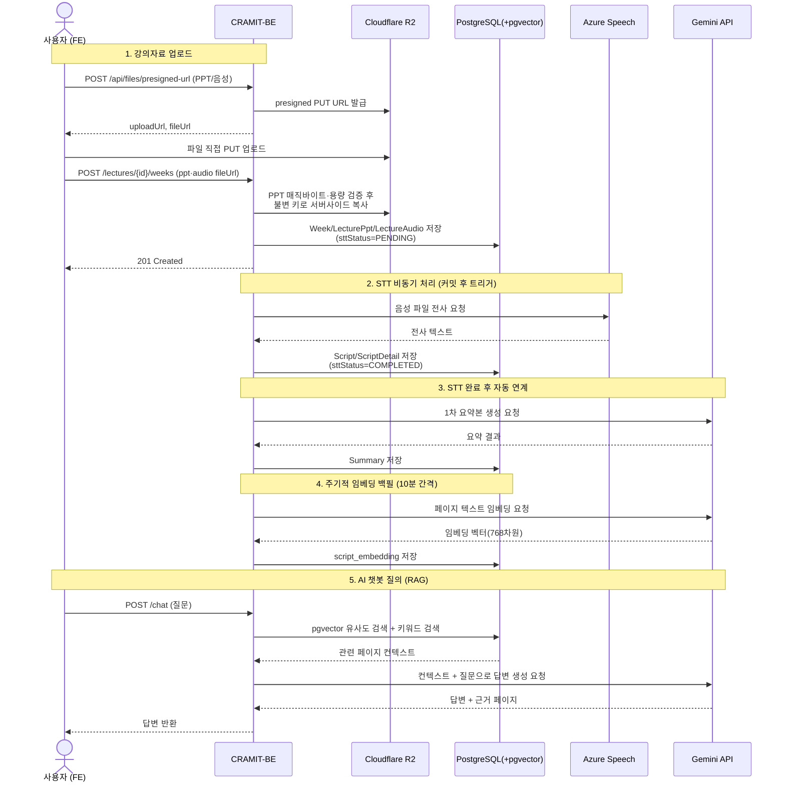

<p align="center">
  


</p>

<div>

## ⚡️ CRAMIT

> **"CRAM IT: Cram more in less time." <br> 더 적은 시간에, 더 많은 것을 머릿속에 채우다.**
 
</div>

<br>

## 📌 Cramit은 이런 서비스예요

> 대학생들은 강의자료, 강의 녹음, 필기, 개인 메모 등을 여러 플랫폼에 나누어 관리하며 시험 기간마다 다시 정리해야 하는 불편함을 겪는다. Cramit은 강의자료와 강의 녹음을 AI로 분석하여 자동 요약을 제공하고, 사용자가 학습하며 추가한 메모와 학습 포인트까지 함께 활용하는 통합 학습 환경을 제공하기 위해 개발되었다.

### 🔥 강의자료와 강의 녹음을 하나로

> PDF와 STT를 페이지 단위로 자동 매핑해, 원하는 페이지만 골라 다시 들을 수 있습니다

강의자료(PDF)를 업로드하고 강의를 녹음하면, 녹음 종료 즉시 STT가 자동 생성되고 강의자료 페이지와 STT 구간이 자동으로 매핑된다. '해당 페이지 수업 듣기' 버튼 하나로 필요한 구간만 빠르게 재청취할 수 있다.

### 🔥 AI 요약본 생성

> 강의자료(PDF)와 STT를 함께 분석하여 Markdown 형태의 요약본을 생성합니다

'요약본 생성' 버튼 클릭 시 AI가 강의자료와 STT를 종합 분석하여 페이지별 핵심 내용을 정리한 요약본을 생성한다. 교수가 강조한 내용은 별도로 표시된다.

### 🔥 메모와 학습 포인트

> 학습 중 남긴 메모와 학습 포인트가 챗봇·학습 계획에도 반영됩니다

요약본에서 원하는 텍스트를 드래그해 메모를 남기거나 학습 포인트를 생성할 수 있다. '학습 내용 적용' 버튼을 누르면 이 기록들이 프로젝트에 반영되어, 이후 AI 챗봇 답변과 학습 계획 생성에도 함께 활용된다.

### 🔥 AI가 도와주는 시험 대비 학습 플랜

> 시험 일정을 등록하면 AI가 날짜별 학습 계획(TODO)을 자동으로 만들어줍니다

시험 일정과 D-Day를 등록하면, 프로젝트의 학습 진도와 내용을 분석해 AI가 날짜별 학습 계획을 자동 생성한다. TODO는 AI 생성 외에 직접 추가·수정도 가능하다.

<br>

## 👤 CRAMIT의 구성원을 소개합니다!

|  |  |  |  |
|:---:|:---:|:---:|:---:|
| [배서윤](https://github.com/seooyoon) | [엄정인](https://github.com/jungini1123) | [강준우](https://github.com/oofrog) | [박태현](https://github.com/nuyh-99) |
| 인증(OAuth/JWT)<br>CI/CD · 보안<br>RAG · pgvector | 강의 · 주차 · Todo<br>챗봇 · 요약 | 홈 화면 · API 연동<br>STT · 페이지매핑 | 로그인 · 온보딩<br>학습 뷰어 · 챗봇 UI |

<br>

## 기술 스택

| 구분 | 기술 | 용도 |
| --- | --- | --- |
| Language |  | Backend Application |
| Framework |  | REST API Server |
| Security |   | Authentication & Authorization |
| ORM |  | ORM |
| Query Builder |  | Dynamic Query |
| Database |  | AWS RDS · pgvector(벡터 검색) |
| Cache |  | 리프레시 토큰 저장 |
| Migration |  | Schema Version Management |
| AI |  | AI Features (챗봇·요약·Todo·임베딩) |
| STT |  | Speech-to-Text |
| Storage |  | File Storage (S3 호환 API) |
| Async |   | Async Processing & Fault Tolerance |
| API Docs |  | API Documentation |
| Testing |   | Unit & Integration Test |
| Build & Deploy |    | Build & Deployment |

<br>

## 아키텍처


<br>
<br>

**CRAMIT**은 저장소 안에서 코드로 관리하는 부분과, AWS·외부 서비스 콘솔에서 직접 관리하는 부분을 나누어 운영합니다.

#### 저장소에서 관리하는 구성

- `docker-compose.yml` / `docker-compose.prod.yml`에서 app(Backend) · Redis · Nginx · certbot 컨테이너를 정의하고, 하나의 **AWS EC2** 인스턴스에서 함께 운영합니다.
- `.github/workflows/cd.yml`에서 **GitHub Actions**가 OIDC로 발급받은 임시 자격 증명으로 EC2에 SSH 접속해, 별도 이미지 레지스트리(Docker Hub 등) 없이 EC2 안에서 직접 `docker compose build/up`까지 수행합니다.
- `docker/nginx`, `docker/certbot`에서 리버스 프록시 설정과 Let's Encrypt 인증서 발급 스크립트를 관리합니다.
- `application-prod.yml`에서 외부 PostgreSQL(RDS), Cloudflare R2, OAuth Redirect URI 등 운영 환경 연동 설정을 관리합니다.

#### 저장소 외부(AWS 콘솔 등)에서 관리하는 인프라

- **AWS RDS(PostgreSQL) · Cloudflare R2**: 영구 데이터와 파일 데이터를 분리해 저장하며, 각 콘솔에서 직접 프로비저닝합니다. 코드는 AWS S3 SDK를 그대로 재사용하지만(S3 호환 API) 실제 저장소는 Cloudflare R2이고 AWS S3는 쓰지 않습니다. 접속 정보는 환경 변수로만 주입합니다.
- **도메인 · DNS**: 백엔드 도메인(`cramit-api.me`)의 DNS 레코드와 TLS 인증서 발급 상태는 레지스트라·서버에만 존재하며 저장소에 커밋되지 않습니다.
- **GitHub Actions Secrets · IAM 최소 권한 정책 · CloudTrail**: 배포에 필요한 자격 증명과 AWS 계정 보안 설정은 각 콘솔의 UI로만 관리하고, 코드로 드러나지 않습니다.
- **Kakao/Google OAuth 소셜 로그인 · Gemini API · Azure Speech**: 외부 서비스로 연동하여 운영 편의성, 데이터 안정성, 서비스 간 역할 분리 및 확장성을 확보했습니다.


<br>


## 핵심 처리 흐름



<br>

## ⚙️ 실행 환경

- **JDK 버전**: `17`
- **빌드 도구**: Gradle
- **여는 방법**
  ```bash
  git clone https://github.com/cramit-service/cramit-be.git
  cd cramit-be
  ```

  `src/main/resources/application-local.yml`에 아래 정보를 입력합니다.

  - Database
  - JWT Secret
  - Kakao OAuth
  - Google OAuth
  - Gemini API Key
  - AWS Credentials

  > `application-local.yml`은 `.gitignore`에 포함되어 있습니다.

- **실행**
  
  ```bash
  ./gradlew bootRun
  ```

- **Swagger**

  ```text
  http://localhost:8080/swagger-ui/index.html
  ```

<br>

## 🔗 Git Convention

### 1️⃣ Git Flow

```
  develop ← 작업 브랜치
```

- `main branch` : 배포 브랜치
- `develop branch` : 개발 브랜치, feature 브랜치가 merge됨
- `feature / chore / refactor branch` : 개발 브랜치

  <br/>

### 2️⃣ Flow

- 이슈 생성
- 이슈 번호에 맞게 `develop` 브랜치에서 새로운 브랜치 생성
- 작업 완료 후 커밋 컨벤션에 맞게 커밋
- PR 생성
- 코드 리뷰 후 `develop` 브랜치로 병합
  - 최소 1명 승인 후 `develop` 브랜치로 머지

  <br/>

### 3️⃣ Branch Naming Convention

- **구조**: `브랜치종류/#이슈번호-기능설명`
- **구분자**: 하이픈(`-`) 사용

| Prefix     | 설명               |
| ---------- | ------------------ |
| `init`     | 초기 프로젝트 세팅 |
| `feat`     | 새로운 기능 추가   |
| `fix`      | 버그 수정          |
| `docs`     | 문서 변경          |
| `style`    | UI 수정            |
| `refactor` | 코드 리팩토링      |
| `test`     | 테스트 코드 관련   |
| `chore`    | 설정 파일 변경     |
| `hotfix`   | 긴급한 버그 수정   |
| `deploy`   | 배포 관련 작업     |

  <br/>

### 4️⃣ Commit Message
  - `init: 프로젝트 초기 세팅 (#1)`
  - `feat: 로그인 API 구현 (#2)`

| Prefix     | 설명               |
| ---------- | ------------------ |
| `init`     | 초기 프로젝트 세팅 |
| `feat`     | 새로운 기능 추가   |
| `fix`      | 버그 수정          |
| `docs`     | 문서 변경          |
| `style`    | UI 수정            |
| `refactor` | 코드 리팩토링      |
| `test`     | 테스트 코드 관련   |
| `chore`    | 설정 파일 변경     |
| `hotfix`   | 긴급한 버그 수정   |
| `deploy`   | 배포 관련 작업     |

  <br/>

### 5️⃣ API Response Status Code Convention

| 상황 | HTTP Status | 설명 |
|---|---|---|
| 생성 (POST) | 201 Created | 새 리소스 생성 성공 |
| 조회 (GET) | 200 OK | 조회 성공 |
| 수정 (PATCH) | 200 OK | 수정 성공, 수정된 데이터 반환 |
| 삭제 (DELETE) | 204 No Content | 삭제 성공, 반환 데이터 없음 |
<div>

<br>

## 📂 프로젝트 구조

```
📦 cramit-be
├─ 📁 .github
│  ├─ 📁 ISSUE_TEMPLATE
│  │  ├─ 📄 feat.md              # [FEAT] 이슈 템플릿
│  │  ├─ 📄 chore.md             # [CHORE] 이슈 템플릿
│  │  └─ 📄 bug.md               # [BUG] 이슈 템플릿
│  ├─ 📁 workflows
│  │  ├─ 📄 ci.yml               # 테스트/보안 스캔 CI
│  │  └─ 📄 cd.yml               # develop 머지 시 운영 서버 자동 배포(CD)
│  └─ 📄 pull_request_template.md
├─ 📄 .coderabbit.yaml           # CodeRabbit 리뷰 언어/설정
├─ 📄 .gitattributes             # 줄바꿈(EOL) 통일 설정
├─ 📄 .gitignore
├─ 📄 .dockerignore
├─ 📄 .env.example               # 로컬 docker-compose용 환경변수 템플릿
├─ 📄 .env.prod.example          # 운영(EC2) 환경변수 템플릿
├─ 📄 Dockerfile
├─ 📄 docker-compose.yml         # 로컬 PostgreSQL(pgvector)·Redis 컨테이너
├─ 📄 docker-compose.prod.yml    # 운영 배포용(app·nginx·certbot)
├─ 📁 docker
│  ├─ 📁 nginx                   # 운영 리버스 프록시 설정
│  └─ 📁 certbot                 # TLS 인증서 발급
├─ 📁 gradle/wrapper
├─ 📄 gradlew / gradlew.bat
├─ 📁 src
│  ├─ 📁 main
│  │  ├─ 📁 java/com/cramit
│  │  │  ├─ 📄 CramitApplication.java
│  │  │  ├─ 📁 global
│  │  │  │  ├─ 📁 config           # Security, Async, Querydsl, Resilience 등 설정
│  │  │  │  ├─ 📁 exception        # 전역 예외처리, 에러코드 enum
│  │  │  │  ├─ 📁 security         # JWT, OAuth2 관련
│  │  │  │  ├─ 📁 common           # 공통 응답 포맷, 유틸
│  │  │  │  ├─ 📁 async            # 비동기 처리 공통 설정
│  │  │  │  ├─ 📁 external         # 외부 API 연동 공통 모듈(타임아웃 분류 등)
│  │  │  │  ├─ 📁 storage          # Cloudflare R2 파일 저장소 설정(AWS S3 SDK 재사용)
│  │  │  │  └─ 📁 logging          # 요청 추적(traceId) 로깅
│  │  │  └─ 📁 domain
│  │  │     ├─ 📁 member           # 회원가입 / 로그인 / 프로필
│  │  │     ├─ 📁 lecture          # 강의 CRUD
│  │  │     ├─ 📁 week             # 주차 관리 / PDF·음성 자료
│  │  │     ├─ 📁 file             # 파일 업로드 URL 발급·검증(Cloudflare R2)
│  │  │     ├─ 📁 stt              # 음성 STT (Azure Speech)
│  │  │     ├─ 📁 todo             # TODO (수동 생성 + AI 생성)
│  │  │     ├─ 📁 chat             # AI 챗봇
│  │  │     ├─ 📁 summary          # AI 요약본 생성·조회
│  │  │     ├─ 📁 learning         # 학습 포인트 / 학습 메모
│  │  │     ├─ 📁 share            # 강의 공유 / 공유 게시판
│  │  │     ├─ 📁 exam             # 시험 일정
│  │  │     ├─ 📁 subscription     # 구독 / 요금제
│  │  │     ├─ 📁 term             # 약관
│  │  │     └─ 📁 ai               # Gemini 프롬프트·임베딩 공통 모듈
│  │  └─ 📁 resources
│  │     ├─ 📄 application.yml
│  │     ├─ 📄 application-local.yml       # (gitignore, 개인 환경변수)
│  │     ├─ 📄 application-local.yml.example
│  │     ├─ 📄 application-dev.yml
│  │     ├─ 📄 application-prod.yml
│  │     └─ 📁 db/migration                # Flyway 마이그레이션 스크립트 (V1~V23)
│  └─ 📁 test
├─ 📄 build.gradle
└─ 📄 settings.gradle
```

</div>
